# ERPNext PWAs

Four mobile-first apps (sales, HR, accounts and admin) built on top of ERPNext and Frappe HR, plus the launcher everyone
lands on after login. ERPNext still owns the data and does all the accounting. The apps give each team a simpler front door
than desk: fewer fields, the next step suggested, the gaps behind "the numbers look wrong" flagged and fixable in one
click, and each screen made for a phone as well as a PC.

Made for Southern African small businesses: two currencies on every screen (USD/ZWG out of the box), PAYE from
published tax bands, and the central bank's daily rate. The screenshots below come from a demo site with
**fictional data** (`erp_overrides/demo.py`).

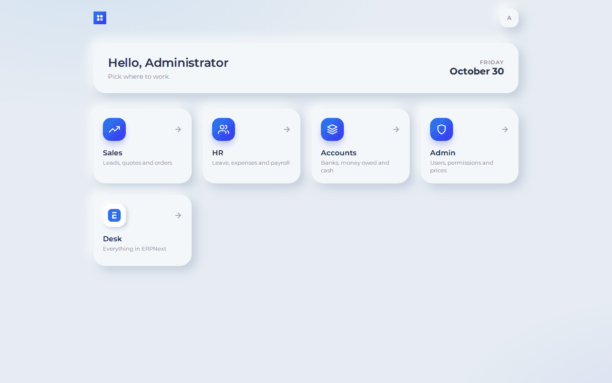

| App | Address | For | Docs |
|---|---|---|---|
| Launcher | `/launcher` | Everyone: one tile per app their roles open, plus Desk | [sysadmin-pwa.md](docs/sysadmin-pwa.md#landing-page-launcher) |
| Sales | `/sales` | Lead → quotation → order → invoice, and buying for an order | [sales-pwa.md](docs/sales-pwa.md) |
| HR | `/hrms-admin` | Leave, payroll, claims, people and bi-weekly reviews | [hr-admin-pwa.md](docs/hr-admin-pwa.md) |
| Accounts | `/accounts` | Bank reconciliation, money owed, payments, petty cash, exchange rates | [accounts-pwa.md](docs/accounts-pwa.md) |
| Admin | `/sys-admin` | Users and roles, why someone can't open something, item prices and imports | [sysadmin-pwa.md](docs/sysadmin-pwa.md) |

## Screenshots

### Sales

| Desktop | Phone |
|---|---|
| 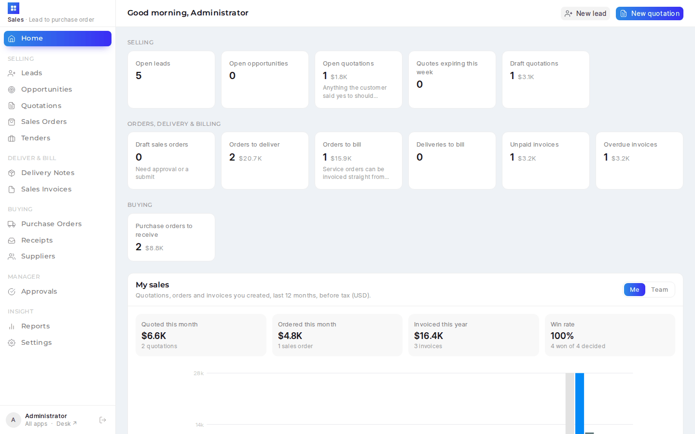 | 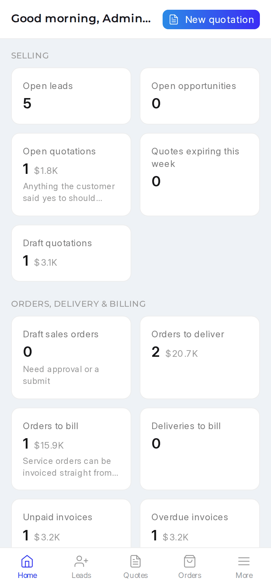 |
| 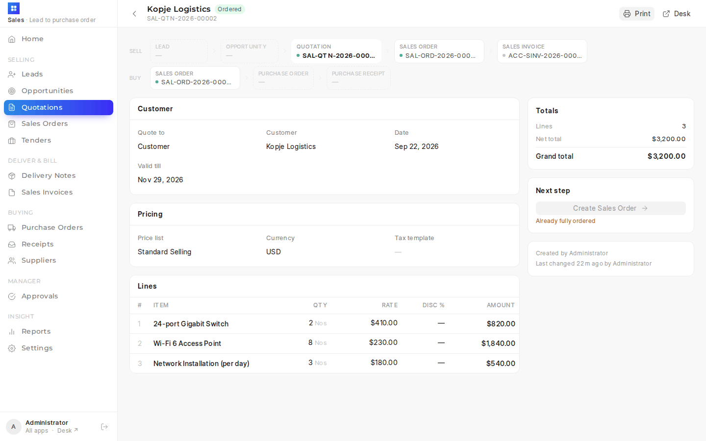 | 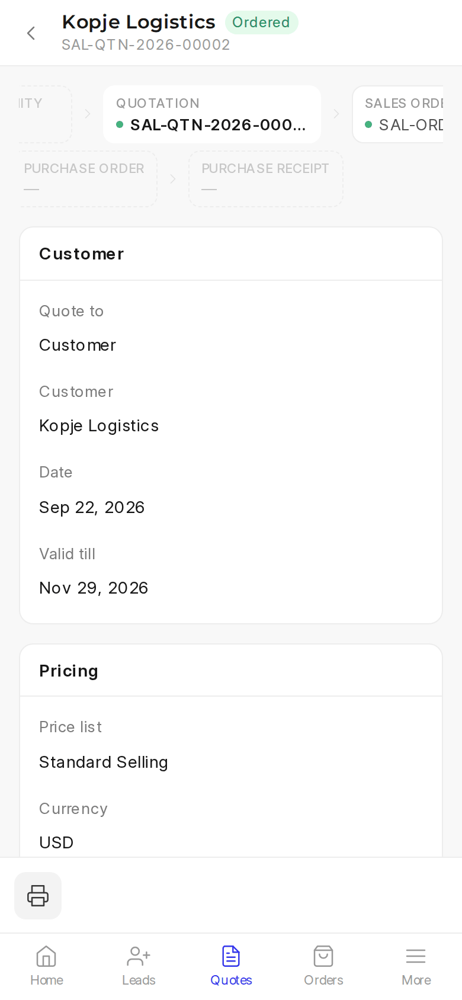 |
| 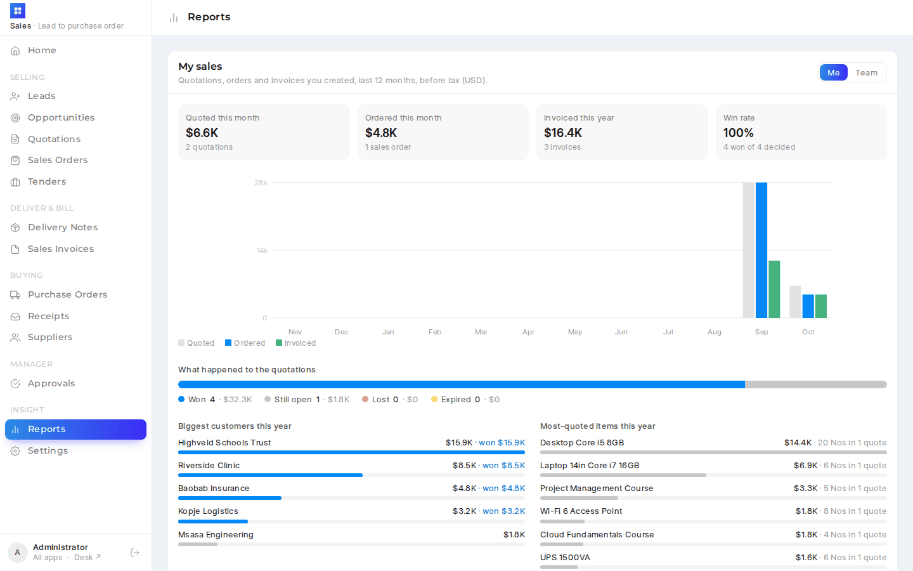 | 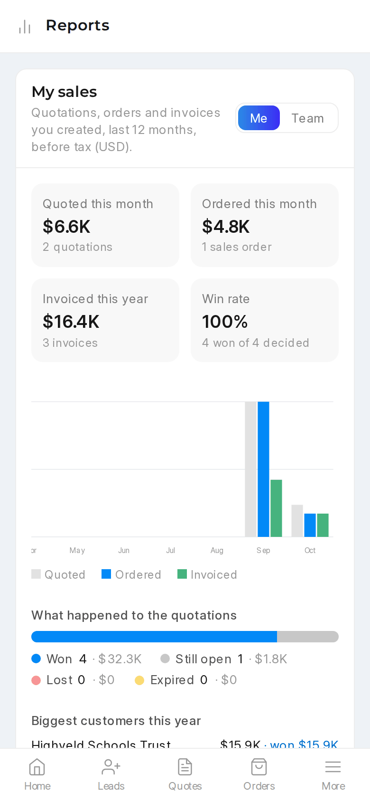 |

### HR

| Desktop | Phone |
|---|---|
|  |  |
|  |  |
|  |  |

### Accounts

| Desktop | Phone |
|---|---|
|  |  |
|  |  |

### Admin

| Desktop | Phone |
|---|---|
| 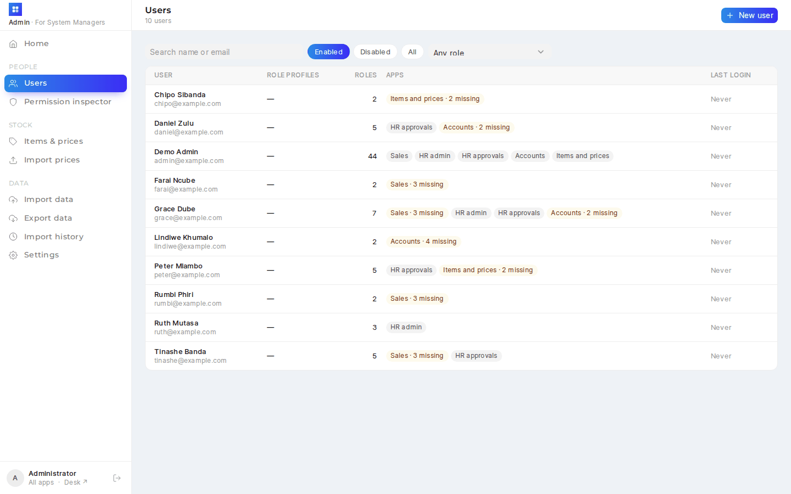 | 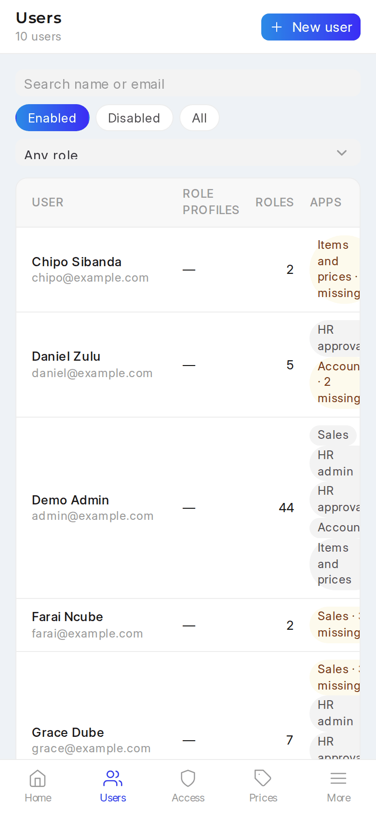 |
| 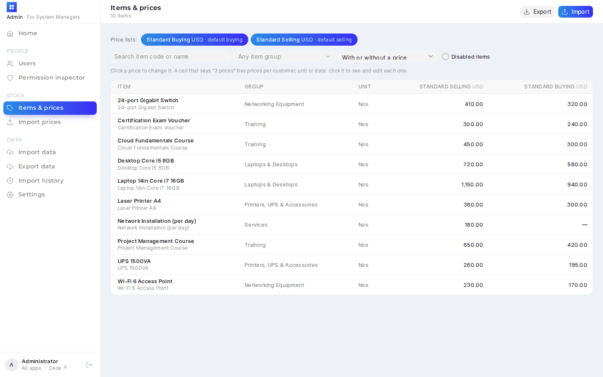 | 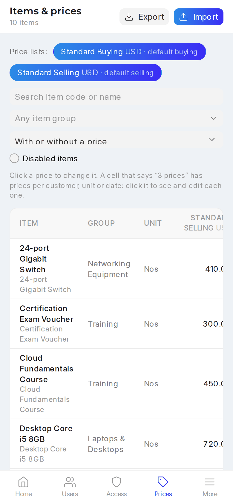 |

More screens are in each app's doc, and every capture is in [`docs/screenshots/`](docs/screenshots).

## How it's built

- **Frontend:** Vue 3, [frappe-ui](https://github.com/frappe/frappe-ui), Tailwind and Vite, with `vite-plugin-pwa`, so each app
  installs to a phone's home screen. There's one `frontend/` folder with four Vite configs (`vite.config.js`,
  `vite.hr.config.js`, `vite.accounts.config.js`, `vite.sysadmin.config.js`) that share components.
- **Backend:** whitelisted methods in `erp_overrides/api/` (`sales.py`, `hr.py`, `pay_setup.py`, `reviews.py`, `accounts.py`,
  `sysadmin.py`, …). Every method checks the caller's roles and goes through ERPNext's own documents, so desk's validation,
  permissions and version history still apply.
- **Server-side rules:** document hooks in `hooks.py`. These include a three-way match before a supplier is paid
  (`three_way.py`), light-touch stock for hardware bought to order (`stock_light.py`), quotation print guards, and a payslip
  format with leave balances (`payslip.py`).
- **Custom doctypes:** bi-weekly reviews (Review, Review Form, Review Schedule), petty cash boxes, the accounts app settings,
  and public tenders for Zimbabwe and Zambia, with the feeds left as stubs (see below).
- **Tests:** `erp_overrides/tests/` has a module per API (`run-tests --app erp_overrides`).

Requires Frappe, ERPNext and Frappe HR **v16**, Python 3.14 and Node 20+.

## Try it

```bash
bench get-app https://github.com/Zawala/erpnext_overrides.git
bench new-site demo.localhost --install-app erpnext --install-app hrms --install-app erp_overrides
bench --site demo.localhost execute erp_overrides.demo.seed     # fictional company, staff and transactions
bench build --app erp_overrides
bench start
```

Open http://demo.localhost:8000/launcher and log in as `Administrator` (the password you gave `new-site`), or as
any demo user (`grace@example.com`, `ruth@example.com`, `daniel@example.com`, …) with the password `demo1234`.

For frontend development, run `cd frontend && yarn dev` (sales), `yarn dev:hr`, `yarn dev:accounts` or `yarn dev:sysadmin`.
Each one proxies API calls to the bench.

## Tenders and exchange rates across SADC

The app is wired for two daily feeds: new **public tenders** from national e-procurement portals, shown on a Tenders page and
emailed as a digest, and the **central bank's exchange rate** written into ERPNext every weekday. The fetching code is left
out, and `erp_overrides/scrapers.py` has stubs with the same entry points. [docs/sadc-data-feeds.md](docs/sadc-data-feeds.md)
covers how the same design extends to SADC's 16 member states and how to plug in a source.

## License

MIT
