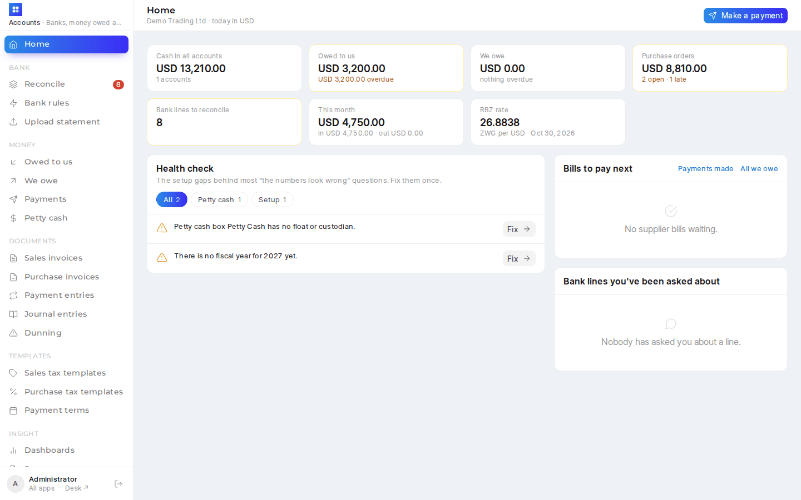
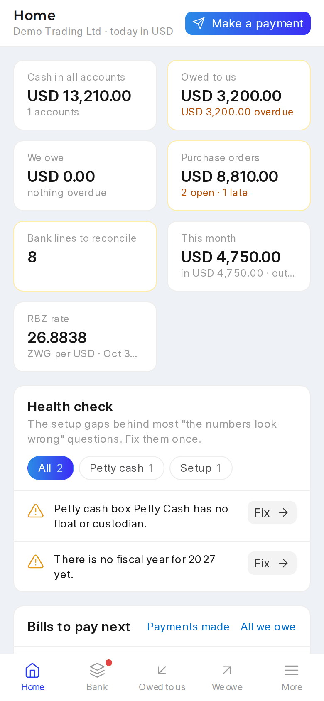
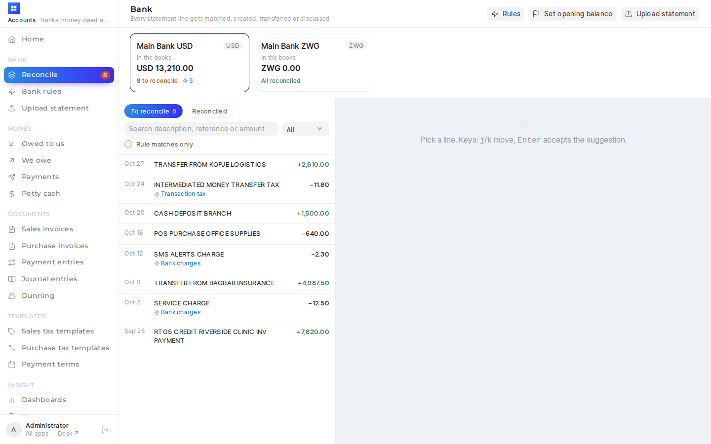
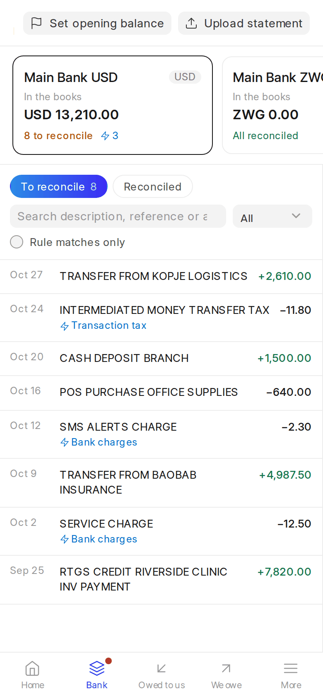
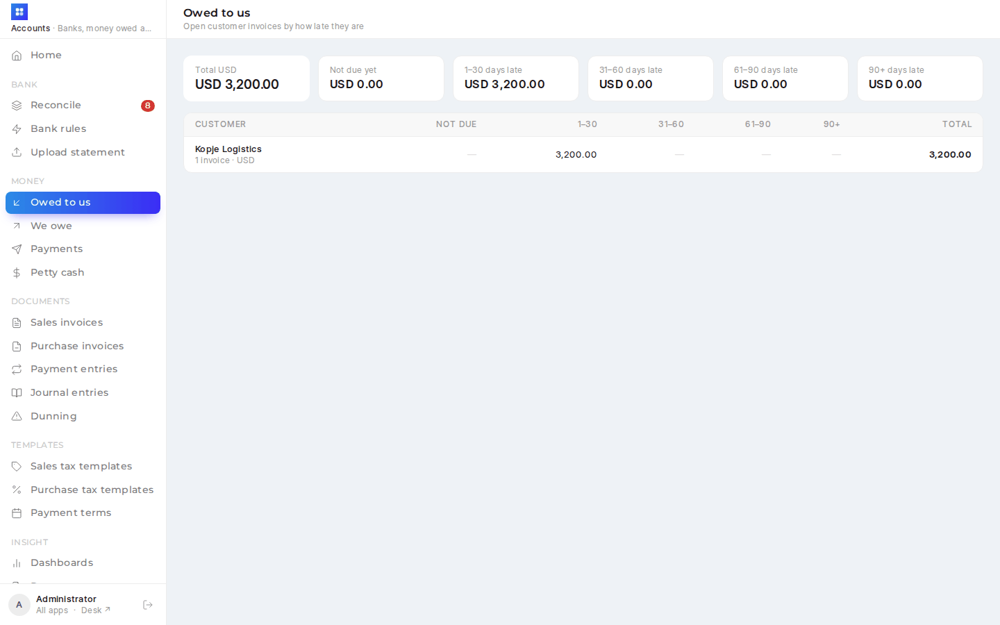
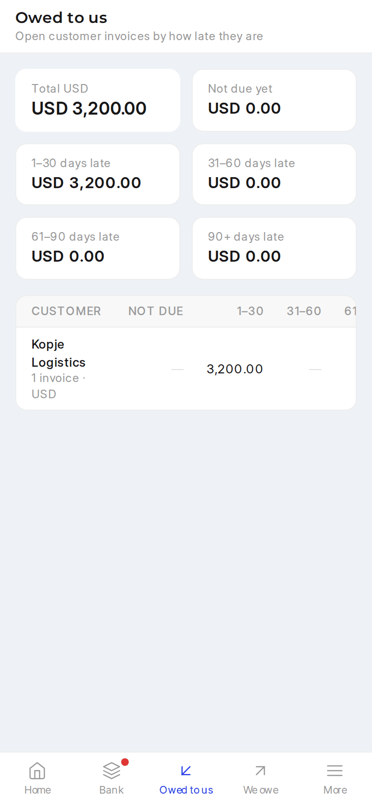
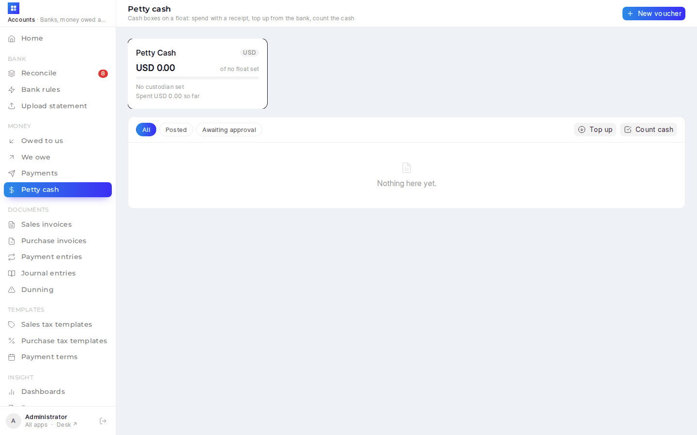
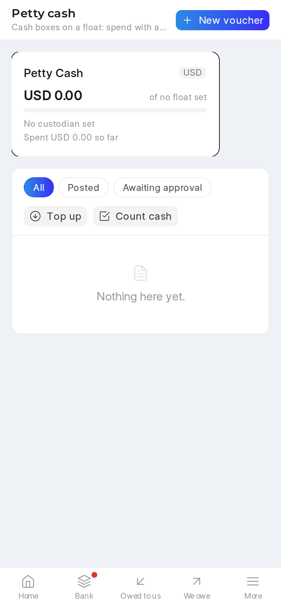

# Accounts PWA (`/accounts`)

<details><summary>Screenshots (demo data)</summary>

| Desktop | Phone |
|---|---|
|  |  |
|  |  |
|  |  |
|  |  |

</details>

The accounts team's front door: the bank reconciliation, money owed and cash views a finance team expects from a small-business accounting package, on top of ERPNext. ERPNext still does all the accounting.

| Who | Sees |
|---|---|
| Accounts Manager / Accounts User / System Manager | Everything below |
| Sales / Purchase / HR Manager, Auditor, Finance Manager (no accounts role) | **Read-only** Home, Dashboards and Reports |

Anyone else is turned away. Users reach it from the **Accounts** tile on `/launcher`, where everyone lands after login ([landing page](sysadmin-pwa.md#landing-page-launcher)).

## Pages

| Page | What it does |
|---|---|
| Home | Tiles: cash in all accounts (other currencies at today's rate), owed to us, we owe, bank lines to reconcile, this month in/out, RBZ rate. The **health check** with a Fix on every row. Bank lines a colleague asked you about (Discuss). **Bills to pay next** (8 soonest-due supplier bills, each with its match badge and **Pay**; Pay is greyed out for a bill that isn't matched). |
| Bank | One card per company bank account: balance in the books, the statement's closing balance, lines to reconcile, rule matches. Statement lines on the left (search, money in/out, *Rule matches only* with bulk **OK**: it posts every rule match under the current search and filter, not just the loaded page, in batches of 25 with a running count; tick lines to post only those); the picked line on the right with Xero's tabs — **Match** (uncleared payments and journals, ERPNext's ranking, plus open invoices of the same amount: *Pay this* records the payment), **Create** (who / what / why, VAT split optional), **Transfer** (between our accounts, the other side's line found and reconciled too), **Discuss** (comment, ask a colleague). A green bar offers the one-click suggestion: the line's rule, an exact match, or the invoice it pays. Keys: j/k move, Enter accepts. **Reconciled** tab with Undo. |
| Bank rules | Rules by priority with the lines each is waiting on; create/edit with a live "would catch N lines" count. "Make a rule for lines like this" on any line prefills one. |
| Upload statement | CSV, XLS/XLSX or PDF. ERPNext detects the header row and columns (fixable); the preview marks lines already imported, which are skipped. Rules run on the new lines. |
| Set opening balance | On Bank, for an account with no opening journal yet: the statement's balance on the go-live date, posted as an opening Journal Entry against **Temporary Opening** in the bank's currency (`set_opening_balance`). Once it has one, the button goes; cancel that journal in desk to change it. |
| Owed to us / We owe | Open invoices per customer / supplier in ageing buckets by due date, per currency; a party opens to its invoices with **Receive** / **Pay** (supplier bills show their match badge; an unmatched one can't be paid). **We owe** starts with **Orders to bill**: open purchase orders with something received but not billed, each with **Bill this order** — a draft Purchase Invoice for exactly what was received and not yet billed (`bill_order`), opened under Purchase invoices to add the supplier's invoice number, date and attachment, then submit. **New bill** (bills with no order: rent, utilities): drop the supplier's PDF or photo, key the lines beside it, saved as a draft Purchase Invoice with the bill attached. |
| Payments | Every payment in and out of the bank and cash accounts (Payment Entries and bank Journal Entries), newest first: paid out / received / transfers; status **Waiting for the statement** (no clearance date), **Cash** (petty cash and cash accounts — no statement to wait for), **Cleared** (matched to a statement line, with a link to it) or **Cancelled**; search, bank account, dates, *Made by me*. Totals per currency, including how much is still waiting. A payment opens to the bills it paid (and anything left on account) or the accounts it went to, with Open in desk, Print, and **Cancel payment** while it isn't matched to a line (a cleared one is undone from Bank → Reconciled). |
| Petty cash | Cash boxes on a float (set up under Settings → Petty cash: cash account, custodian, float, approval limit). Each box: balance against the float, the custodian, what's been spent since the last top-up. **New voucher**: paid to, what for (expense account), amount, optional VAT, receipt photo — a *Cash Entry* journal. Over the box's approval limit it waits as a draft until an **Accounts Manager** approves or declines it (the reason is kept as a comment on the cash account). **Top up** (accounts roles): bank → box, by default back to the float; Bank suggests it when it reaches the statement. **Count cash** (accounts roles): any difference goes to *6545 Cash Over and Short*. A **custodian without an accounts role** gets into `/accounts` for their own box only. |
| Settings | Accounts Manager / System Manager only (see below). |
| Make a payment | Button on Home, Dashboards and Payments (accounts roles only). Pay **a supplier** (tick their open bills, oldest first; anything over goes on account; a bill that isn't matched can't be ticked and says why) or **an expense or other account** (Xero's *Spend money*, VAT-inclusive split optional), from a bank account on a date. Posted and submitted at once; when the line arrives on the statement, Bank suggests it as the match. |
| Dashboards | 12-month cash flow (in vs out of banks, own transfers excluded), cash per account, profit and loss (this month, last month, year to date, biggest costs), budget against actual (empty until budgets exist), the financial statements and an **All reports** link. |
| Reports | Every accounts report the user's roles may open, as links into desk, grouped: financial statements, ledgers, money owed, registers, banking, tax, budget and analysis, purchases, then *Other accounts reports* — every other enabled report in the Accounts and Regional modules (and any custom ones), so a report ERPNext adds later shows up by itself. Search across names and descriptions. Read-only users get it too. |
| Documents | Sales invoices, purchase invoices, payment entries, journal entries and dunning, edited in the app (see *Documents and templates* below). |
| Templates | Sales and purchase tax templates and payment terms templates, edited in the app. |
| Exchange rates | Latest RBZ USD/ZWG, 60-day chart, missing weekdays, **Fetch from RBZ** (`scrapers.sync_rates`, a stub here; see [sadc-data-feeds.md](sadc-data-feeds.md)), every pair and its source. |

## Documents and templates (`/records/…`)

Lists with filter chips and search, and a form for each document: header fields, the item lines (as in the sales app), editable child tables, a Totals panel, **Save**, **Submit**, **Cancel** (asks first; amend a cancelled one in desk), **Print** for submitted documents, and **Desk** for every other field. ERPNext validates on save, and its messages show verbatim. Each entry appears for users whose role can read the doctype (`FINANCE_DOCTYPES` → boot `permissions`); **New** needs create rights.

| Page | Doctype | In the form |
|---|---|---|
| Sales invoices | Sales Invoice | Customer, PO number, dates, payment terms, **tax template** (picking one fills the taxes rows, `get_taxes_and_charges`), lines, taxes. Submitted and unpaid: **Receive payment**; overdue: **Create dunning** |
| Purchase invoices | Purchase Invoice | Supplier, supplier's invoice no. and date, dates, tax template, lines (buying prices), taxes (add/deduct, valuation). Unpaid: **Pay this bill**. A bill from a purchase order shows the **Order · receipt · bill** panel: its match badge and each line's billed, received and ordered figures (`get_match`). *We owe → New bill* and *Bill this order* open their drafts here |
| Payment entries | Payment Entry | Receive / Pay / Internal transfer, party, our bank or cash account, amount, bank reference, and the invoices it pays: **Get outstanding invoices** lists the party's open documents and allocates the amount oldest first (no amount: pays them all). ERPNext fills the party account and exchange rates on save |
| Journal entries | Journal Entry | Type, date, reference, remark, account rows with party, debit and credit; the Totals panel shows the difference until it balances |
| Dunning | Dunning | Made from an overdue sales invoice (**Create dunning**), never from scratch; dunning type, interest, fee, the overdue payments; **Receive payment** while unresolved |
| Sales / purchase tax templates | Sales / Purchase Taxes and Charges Template | Title, company, tax category, default, disabled; tax rows (type, account, rate or amount, description, included in price). Picking the account fills an empty description |
| Payment terms | Payment Terms Template | Name, allocate per term, instalments (portion %, due rule, days/months, mode) |

**Receive payment**, **Pay this bill** and **Create dunning** run ERPNext's own mappers (`get_payment_entry`, `create_dunning`) and open the result unsaved, so it can be checked first. *Owed to us*, *Payments* and *We owe → New bill* open these documents in the app rather than desk (desk when the role can't read the doctype). The registry is `frontend/src/accounts/records.js`; the pages are `pages/RecordList.vue` and `pages/RecordForm.vue`; child tables use the shared `components/ChildTable.vue`.

## Settings (`/settings`)

Accounts Manager and System Manager only: no menu entry for anyone else, and `erp_overrides/api/app_settings.py` refuses them. The page shows petty cash boxes and the over / short account; reconciliation (cross-currency transfer tolerance, when a line counts as stale, ERPNext's fuzzy party matching); invoice rules (over-billing, credit controller, unique supplier invoice numbers, unlinking payments on cancel); the accounts-frozen date on Company; the exchange-rate provider, saved through the documents themselves, and a **Who changed what** panel: every change from Frappe's Version log (who, when, old → new), including changes made in desk. The fields shown are listed in `REGISTRY["accounts"]`; a field missing on a site is skipped.

## How reconciliation posts

Every action ends in ERPNext's own `reconcile_vouchers`, so a reconciled line is the same document the `/banking` app (ERPNext 16, Beta) would produce, and `/banking` stays usable alongside.

- **Match** clears existing Payment / Journal Entries (`get_linked_payments` → `reconcile_vouchers`).
- **Pay this** builds the Payment Entry with ERPNext's `get_payment_entry` for the invoice, then reconciles.
- **Create**, **Transfer** and rule **OK** build the Journal / Payment Entry here rather than through ERPNext's `create_bank_entry_and_reconcile` / `create_internal_transfer`: those post every amount as if in the company currency (a TODO in ERPNext), so a ZWG 1,000 line would land as USD 1,000. Here the bank row stays in ZWG and the USD value comes from that day's RBZ rate; a USD→ZWG transfer carries both amounts.
- **Make a payment** uses the same builders as Create, with the bank side typed in instead of read from a statement line: a Payment Entry allocated to the ticked bills, or a bank Journal Entry. A ZWG bank is valued at the day's RBZ rate.
- **Undo** is ERPNext's `unreconcile_transaction`: entries made from the line are cancelled.

Duplicate check on upload: same date, amounts and description (the reference is ignored — CSV exports often drop it). ERPNext's own statement import has no duplicate check.

## What's where

| Path | Purpose |
|---|---|
| `erp_overrides/api/accounts.py` | Whitelisted backend: banks, lines, the four tabs, rules, upload, money owed, dashboards, reports (`REPORTS` / `get_reports`), rates, health. `FINANCE_DOCTYPES` lists the doctypes the app works with (boot permissions, the Admin app's access check) |
| `erp_overrides/api/reports.py` | `report_groups()`: curated groups plus every other enabled report in the given modules, only those the user may open; shared with the sales app |
| `erp_overrides/api/app_settings.py`, `frontend/src/components/SettingsPage.vue` | Settings pages for all three apps (registry, history), `tests/test_app_settings.py` |
| `erp_overrides/www/accounts.py` | Page boot: user, company, `can_post` / `read_only`, bank accounts |
| `frontend/accounts.html`, `frontend/vite.accounts.config.js` | Third Vite entry (dev port 8082), output `erp_overrides/public/accounts` |
| `frontend/src/accounts/` | `api.js` (`acc()`, `cur()`), `router.js` (`postOnly` and record guards), `records.js` (Documents and templates), `components/AccShell.vue`, `components/LinePanel.vue`, `pages/` |
| `frontend/src/components/ChildTable.vue`, `ReportsGrid.vue` | Editable child table; grouped report links with search (both apps) |
| `erp_overrides/tests/test_reports.py` | Report lists: curated then the rest, disabled and missing left out, only reports the role may open, every Accounts / Selling / CRM report listed |
| `erp_overrides/tests/test_accounts_api.py` | 34 tests: create (USD, ZWG, party), match, invoice payment, transfers (same and cross-currency), rules, discuss, undo, upload duplicates, supplier bill, receipt, make a payment (expense, bills + on account, wrong supplier's bill, no role), payment tracking (waiting → cleared, bills shown, cancel), petty cash (limit and approval, custodian access, top-up, count, ZWG box, cash status), access |

Printing a Payment Entry, Journal Entry, Purchase Invoice or Dunning uses the sales app's print endpoint (`PRINTABLE` in `api/sales.py`), and invoice lines are priced by its `get_item_details` (the boot carries the selling and buying price lists).

## Three-way match

(`erp_overrides/three_way.py`, patch `three_way_2026_10`): a supplier payment can only settle bills that are Matched (billed ≤ received, rate within the order's plus the over-billing allowance) or have no PO. The rule, the badges and the Accounts Manager override (**Approved unmatched payment**, permission level 1) are described in [sales-pwa.md](sales-pwa.md#three-way-match). Receiving is done in the sales app (Purchase Order → **Receive**).

## Build / deploy

`yarn build` (or `bench build --app erp_overrides`) builds all four apps; the output is git-ignored. For development, `yarn dev:accounts` serves http://<site>:8082/accounts with hot reload and proxies API calls to the bench on :8000.

```bash
bench --site $SITE migrate
bench build --app erp_overrides
bench --site $SITE clear-cache && bench restart
```

## Settings (`App Accounts Settings`)

The petty cash boxes (each on its own cash account, with a float and a custodian), the Cash Over and Short account
used by cash counts, the transfer tolerance (3% by default) and how many days make a statement line stale (60). The
demo seed sets one box up; the health check asks for whatever is missing.
