# HR admin PWA (`/hrms-admin`)

<details><summary>Screenshots (demo data)</summary>

| Desktop | Phone |
|---|---|
| 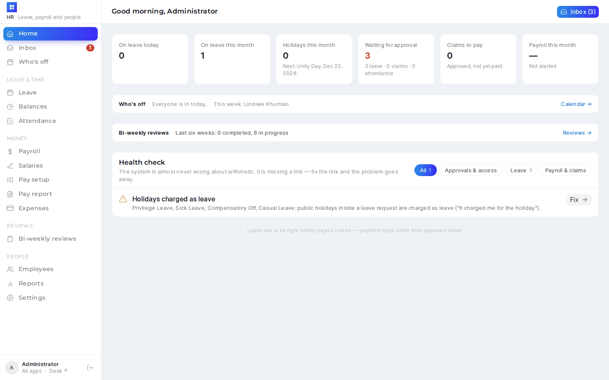 | 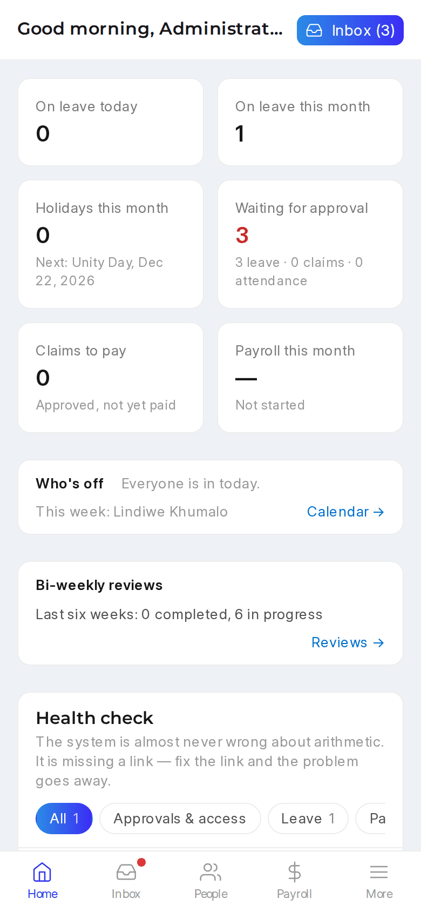 |
| 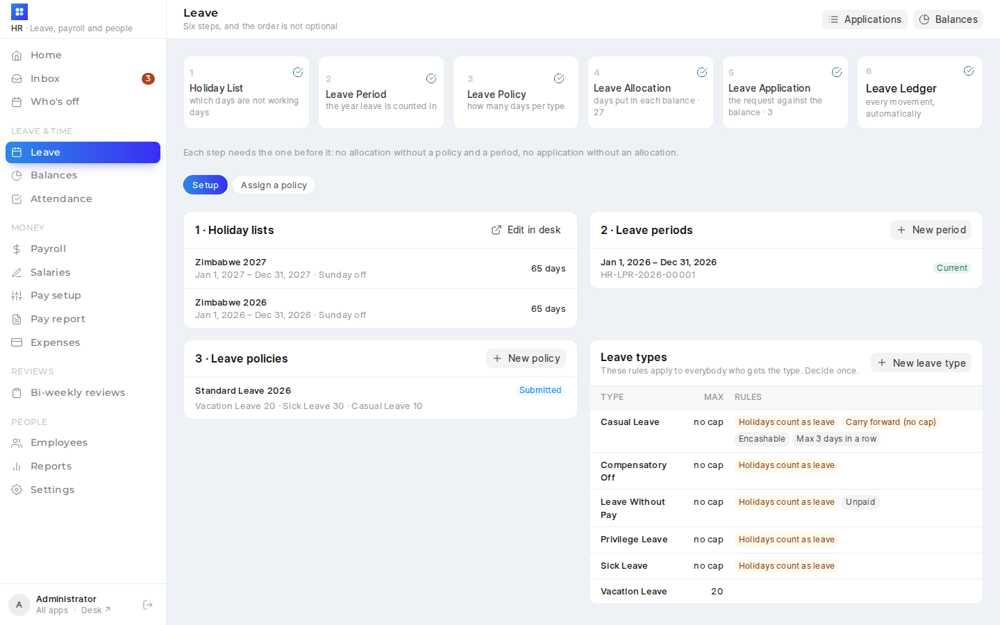 | 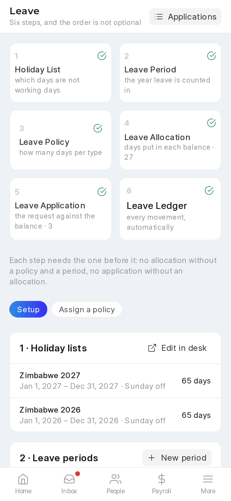 |
| 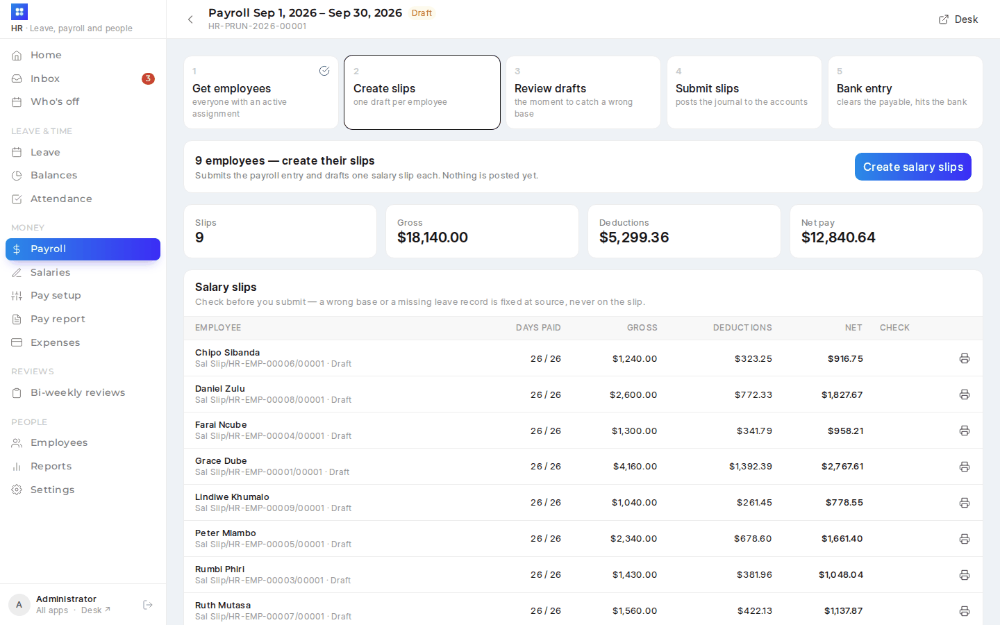 | 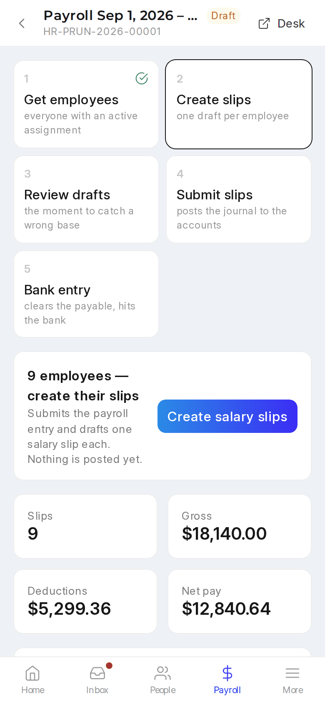 |
| 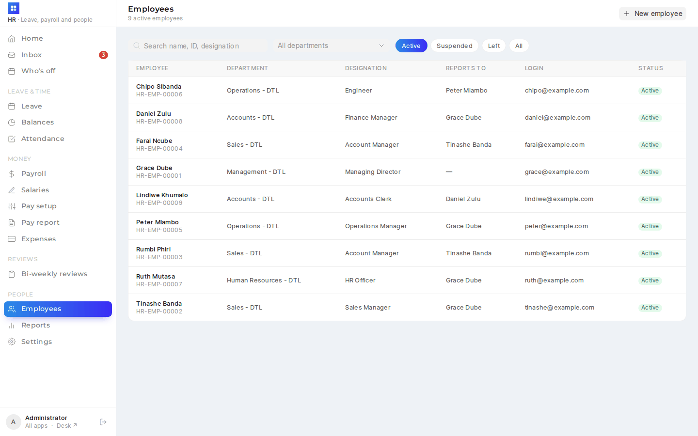 | 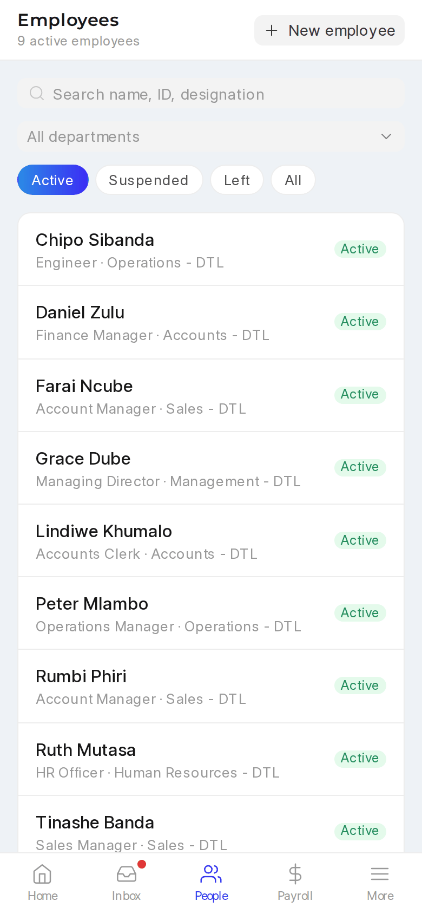 |
| 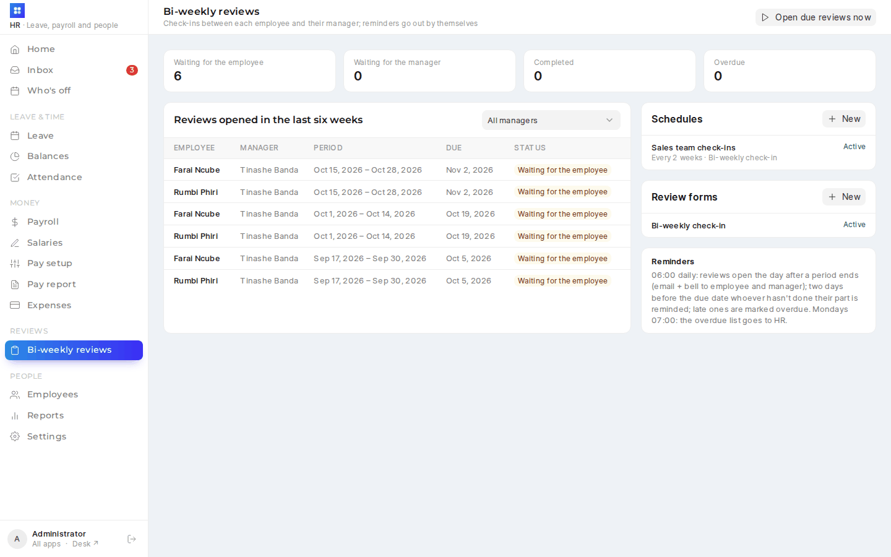 | 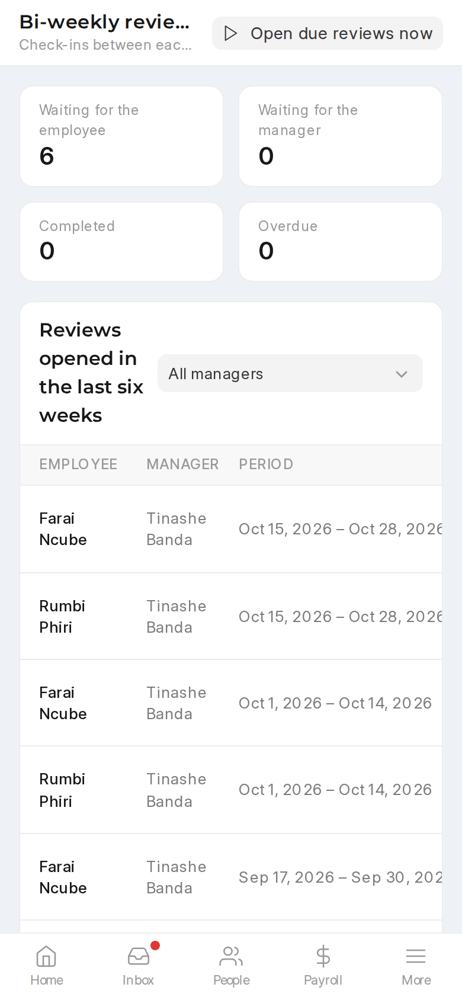 |
| 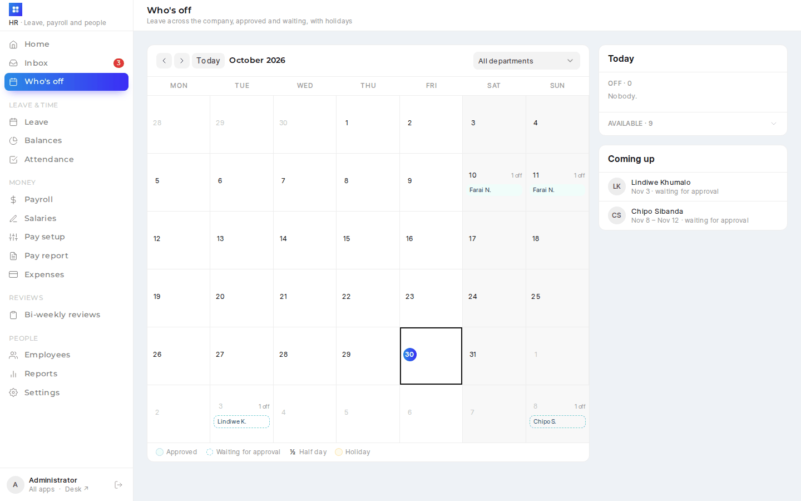 | 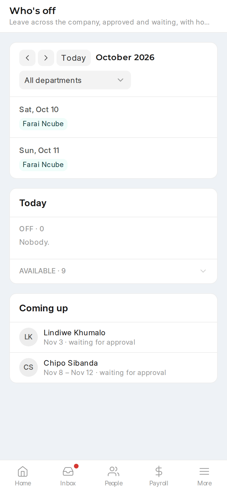 |

</details>

The HR and managers' side of Frappe HR. Employees keep using `/hrms` for self-service, opened from the **My HR** tile on `/launcher`; this app replaces desk for everyday HR work.

Sister apps in the same `frontend/`: [sales](sales-pwa.md), [accounts](accounts-pwa.md) and [admin](sysadmin-pwa.md). After login everyone lands on `/launcher`, which has a tile for each app they can open ([landing page](sysadmin-pwa.md#landing-page-launcher)).

| Who | Sees |
|---|---|
| HR Manager / HR User / System Manager | Everything below |
| Leave Approver / Expense Approver (supervisors) | Home, Inbox and Team balances — only for their team — and Who's off |
| Any other employee (an active Employee linked to their user) | **Who's off** and **My reviews** only (boot `employee_only`; every other route redirects to Who's off) |

A supervisor's **team** is everyone whose leave approver, expense approver or Reports To is them, plus departments where they are a department approver (`erp_overrides.api.hr.get_team`). Anyone with no active employee record gets "not for you" and is pointed at `/hrms`.

## Pages

| Page | What it does |
|---|---|
| Home | A **Who's off** strip (off today, off later this week) and tiles (on leave today/month — both open Who's off, holidays, waiting for approval, claims to pay, payroll this month) and the **health check**: every missing link, with a Fix button |
| Who's off (`/calendar`) | The leave calendar for the whole company (see *Who's off* below). Also a **Who's off** tile on `/launcher` for every employee, since Frappe HR's `/hrms` can't be extended |
| Inbox | Leave, expense claims and attendance requests in one queue. Approve / reject with a comment; reduce a claim line's sanctioned amount; see the balance after approval and who else in the department is away |
| Leave | The six steps with their state; holiday lists, leave periods, policies, leave-type rules; **Assign a policy** to many people at once (allocations are created by HRMS) |
| Balances | Person × leave type, remaining / allocated, taken and pending |
| Attendance | Mark a group for a date; requests list |
| Payroll | Who will / won't get a slip this month (a missing or zero salary's Fix opens Salaries for that person), then the run: get employees → create slips → review drafts (flags: net 0, part-paid days, no PAYE) → submit → bank entry |
| Salaries | Type each person's **net** (take-home) or gross. The page finds the gross whose payslip nets exactly that — priced by HRMS itself (pension, PAYE from the tax slab, levies on the tax), so the real slip matches — and shows the payslip lines. Saving makes a submitted Salary Structure Assignment from the chosen date (replacing one from the same date unless a submitted slip used it) and keeps the **agreed net** on it. If a later full-month slip nets something else (e.g. tax bands change), Home and this page flag it and **Re-gross** works the gross out again |
| Pay setup | What a payslip is made of: salary structures, components and the PAYE bands, in plain language, with a live sample payslip. See *Pay setup* below |
| Expenses | Waiting for approval; approved but unpaid (payment stays in desk) |
| Pay report | Per person over any period (this month, last month, year to date, last year, or dates): every earning, gross, every deduction (pension, PAYE…), total deductions, net pay, and components outside net pay (employer contributions, statistical). Click a person for their slips month by month. Filter by department or employee; drafts optional; CSV export. Also linked from Payroll, Reports and each employee's payslips |
| Employees | Directory, and the employee page: the seven links (User ID, approvers, Reports To, holiday list, salary assignment, leave balance), editable login/approver fields, balances, history, and Promote / Transfer / Start exit / Mark as Left |
| Reports | The HR reports (desk), including two custom ones |

## Settings (`/settings`)

HR Manager and System Manager only: no menu entry for anyone else, and `erp_overrides/api/app_settings.py` refuses them. The page shows leave and attendance rules from *HR Settings* (approvers mandatory, leave notifications, backdated leave, standard working hours, mobile check-in, retirement age, employee naming) and *Payroll Settings* (working days basis, holidays, emailing and encrypting slips, **payslip format**, half-day fraction), saved through the documents themselves, and a **Who changed what** panel: every change from Frappe's Version log (who, when, old → new), including changes made in desk. The fields shown are listed in `REGISTRY["hr"]`; a field missing on a site is skipped.

## Who's off (`/calendar`)

Desk's Leave Application calendar (HRMS `get_events`) shows only leave the user may read. This page shows everyone's (`erp_overrides/api/leave_calendar.py`, `frontend/src/hr/components/LeaveCalendar.vue`):

- **Month grid**: each day lists who is off (approved filled, *waiting for approval* dashed, ½ for a half day); the viewer's holidays (`get_holidays_for_employee`, else the company's default list) label the day and weekly offs are shaded. On a phone it is a list of the month's days that have leave or a holiday.
- **The picked day**: who is off, with dates, and who is **available** (people not on a full day off), plus *Coming up*.
- **Department filter**; ranges up to 62 days per request.
- **Leave types stay private**: HR, the person's approvers (`get_team`) and the person see the type and can open the application; everyone else sees "On leave".
- `get_today()` feeds Home's strip.

Approved and open applications are shown; rejected and cancelled ones are not.

## Bi-weekly reviews

Regular check-ins between each employee and their manager, beside HRMS's own appraisals (`erp_overrides/reviews.py`, `erp_overrides/api/reviews.py`, doctypes *Review Form*, *Review Schedule*, *Review*):

| Piece | What it is |
|---|---|
| Review Form (`/review-forms/:name`) | The questions: Rating 1–5, Text, Yes / No or Choice; answered by the employee, the manager or both; required or not; a manager Rating can name an *Employee Feedback Criteria* it counts towards. Live preview as each side sees it |
| Review Schedule (`/review-schedules/:name`) | Who (department / branch / designation, or a list of people), how often (every 2 weeks, weekly, monthly), from which first period, how many days to complete. Shows the next three windows and each person's manager; people with no manager are skipped and listed |
| Review (`/reviews/:name`) | One per person per period. The employee fills their part and sends it (Open → Self done); the manager adds ratings and comments and completes it (→ Completed). A manager may complete without the employee's part once the due date has passed. The manager's answers stay hidden from the employee until completed |
| Reviews (`/reviews`, HR) | The last six weeks: waiting for the employee / the manager / completed / overdue, by manager; schedules and forms; **Open due reviews now** |
| My reviews (`/my-reviews`) | Everyone's own reviews and, for managers, their team's, with what waits on them first. A **My reviews** tile on `/launcher` for anyone with a review or direct reports |

**The manager** is Reports To, else the employee whose user is their leave approver (`reviews.manager_of`).

**Reminders** (`hooks.py` → `scheduler_events`): daily 06:00 `reviews.daily` opens every review whose window has started (the day after the period ends; idempotent per schedule, person and period) and emails both people and adds a bell notification (Notification Log, type Alert, linked to the app); two days before the due date it reminds whoever's part isn't done; after the due date it marks reviews **overdue** (they stay fillable). Mondays 07:00 `reviews.weekly_overdue_summary` emails HR (the schedule's recipients, else every HR Manager) the overdue list by manager.

**Into the appraisal**: when the manager completes a review and the employee has an Appraisal in an *In Progress* Appraisal Cycle covering the period, an Employee Performance Feedback is submitted on it, reviewer = the manager, one rating per criterion on the appraisal's template (the manager's 1–5 on the question linked to that criterion ÷ 5, or the average of their ratings), comments as the feedback text. HRMS then updates the appraisal's average feedback and final score. HR **Reopen** cancels that feedback. Patch `reviews_setup_2026_10` adds four criteria (Quality of work, Delivery on commitments, Collaboration, Initiative), the *Bi-weekly check-in* form and an *Staff Appraisal* template (KRAs Role responsibilities 60% / Customers and team 40%, the four criteria at 25%); it creates no schedule.

Employees and managers have no rights on the Review doctypes; `api/reviews.py` checks every call against the review (employee, manager, or HR).

## What's where

| Path | Purpose |
|---|---|
| `frontend/src/hr/` | The app. It shares `frontend/` (deps, Tailwind) and the sales app's `Field`, `LinkField`, `StatusBadge`, `PrintPreview` and `utils/` |
| `frontend/hr.html`, `frontend/vite.hr.config.js` | Second Vite entry: output `erp_overrides/public/hr-admin/`, manifest "HR Admin" |
| `frontend/src/hr/records.js` | Read-mostly list/detail configs (leave applications, claims, slips, promotions…) |
| `erp_overrides/api/hr.py` | Whitelisted backend. Every action wraps HRMS's own code: `get_leave_details`, `create_assignment_for_multiple_employees`, `create_salary_structure_assignment`, Salary Slip's own `process_salary_structure` (to price trial payslips without saving), `mark_employee_attendance`, Payroll Entry's `fill_employee_details` / `create_salary_slips` / `submit_salary_slips` / `make_bank_entry` |
| `erp_overrides/www/hrms_admin.py` | Boot context (roles, team, permissions) |
| `hooks.py` → `website_route_rules` | `/hrms-admin` and `/hrms-admin/*` → the app |

Payslips print through the sales app's print preview (`Salary Slip` is in `erp_overrides.api.sales.PRINTABLE`).

### Payslips as the employee sees them

- **Payslip format** (Settings → Payroll) is what employees get: Frappe HR's `/hrms` *Download PDF* and the payslip emailed on submit both print with Salary Slip's default print format. The setting is a custom field on Payroll Settings (patch `payslip_format_2026_10`). Saving it sets that default as a Property Setter (`erp_overrides/payslip.py`, hooked on Payroll Settings `validate` / `on_update`); empty means *Standard*. Only Salary Slip formats are offered.
- **Standard Payslip** is a one-page payslip layout and the default: patch `payslip_standard_2026_10` (and `after_install`, since a fresh install skips patches) creates it from `erp_overrides/templates/print_formats/standard_payslip.html` and sets it as the Payslip format. Re-running the installer (`erp_overrides.payslip.install_standard_payslip`) refreshes the layout from the file. The figures come from the jinja method `standard_payslip(doc)` (`erp_overrides/payslip.py`):
  - Employee details: designation, grade, cost centre (the salary assignment's payroll cost centre, else the employee's or their department's), payment days / working days.
  - Deductions: "before tax" ones (e.g. pension), then *Taxable Income* (taxable earnings − before-tax deductions), then PAYE and the AIDS levy split back out of HRMS's single Income Tax line using the levy % on the employee's tax bands, then anything else. Employer costs (levies) aren't printed. Labels: Basic → Basic Salary, Income Tax → PAYE.
  - Banking & medical aid from the Employee: bank name, **Bank Branch** (custom field the patch adds), account number, health insurance provider (else "Not enrolled").
  - The logo is the Company's own (Company → Company Logo), embedded in the PDF; no letter head is added.
- Every payslip preview in this app (the **Payslip** button on a payroll run, **Print** on a salary slip) opens on that format, titled *Payslip as the employee sees it*. Other formats stay in the dropdown and don't change the default.
- **Before any run:** an employee's page has *Preview this month's payslip as … will see it* (HR only, when they have a salary assignment). `hr.preview_payslip` prices a full month from their latest submitted Salary Structure Assignment with HRMS's own calculation, fills the employee details and renders it in the chosen format. Nothing is saved, and there's no download. If HRMS can't price it (no tax slab, no payroll period), it says so: the payroll run would stop on the same thing.

### Pay setup (`/pay-setup`, `erp_overrides/api/pay_setup.py`)

Three tabs; everyone in HR can look, only an HR Manager (or System Manager) can change anything.

- **Salary structures.** A structure reads like a payslip: earnings, then deductions, then employer costs (on the slip, not taken from pay — a levy is a deduction row with *do not include in total / accounts*, as `hr_payroll_setup_2026` set it up). Each line is a component and a choice of how it's worked out:
  - *Fixed amount*; *% of salary* (of the base, or for deductions also of gross pay); *% with a cap* (e.g. a pension: 5% up to $40); *From the tax bands* (PAYE, one per structure); *Advanced formula* (any HRMS formula, using `base`, `gross_pay`, payment days and the short codes of the lines above).
  - The app writes the HRMS formula (`base * 0.045 if base * 0.045 < 31.50 else 31.50`) and reads it back the same way; anything else shows as *Advanced*. Ticks in plain words: *Taxable*, *Comes off before tax*, *Reduced for unpaid days* (also saved as the component's default).
  - Earnings can't be a % of gross pay: HRMS works gross out from the earnings. Formulas are checked for names that aren't worked out before them.
- **Sample payslip.** Every edit is priced by HRMS itself 400 ms later: the draft is submitted inside a savepoint, a month's payslip is worked out for a sample gross (and optionally a chosen employee), and it's rolled back. The difference from the saved version shows under Net pay.
- **Saving.** HRMS locks a submitted structure and won't cancel one an assignment uses. So:
  - nobody on it → it's replaced in place (cancel, delete, insert, submit);
  - people on it → *Save as new version* makes "Staff 2026 (v2)", leaves the original alone, and opens **Move people**: pick a date, see each person's gross (kept) and net before/after, then move them. Moving makes new Salary Structure Assignments from that date through the Salaries page's own `save_salaries`, keeping each base and agreed net, so anyone whose take-home changes is flagged on Home/Salaries for *Re-gross*. Past payslips keep the old version.
  - *Retire* sets a structure inactive (hidden from Salaries; payroll runs leave out anyone on it), so it's only allowed when nobody's current or future salary uses it.
- **Components.** Create one (name, short code, earning / deduction / employer cost, the usual ticks) or change its short code, ticks, description or disabled state. The name can't change; the short code can't change once a structure uses it (formulas may refer to it); a component on an active structure can't be disabled.
- **Tax bands.** The monthly bands as the tax authority publishes them (from, up to, rate; the last is "and above"), extra charges on the tax (e.g. a 3% levy), the start date and whether "before tax" deductions reduce taxable pay. HRMS taxes `income − from + 1`, so bands after the first are stored from their edge + 1 and shown without it. In use → saved as a new version with the same move dialog (people keep their structure, get the new bands).

## Build / deploy

`yarn build` (or `bench build --app erp_overrides`) builds all four apps; the output is git-ignored. For development, `yarn dev:hr` serves http://<site>:8081/hrms-admin with hot reload and proxies API calls to the bench on :8000.

```bash
bench --site $SITE migrate
bench build --app erp_overrides
bench --site $SITE clear-cache && bench restart
```

## Tests

```bash
bench --site <site> run-tests --app erp_overrides --module erp_overrides.tests.test_hr_api
bench --site <site> run-tests --app erp_overrides --module erp_overrides.tests.test_pay_setup
bench --site <site> run-tests --app erp_overrides --module erp_overrides.tests.test_leave_calendar
bench --site <site> run-tests --app erp_overrides --module erp_overrides.tests.test_reviews
```

The payroll-run test skips itself outside the test runner: HRMS commits after creating slips unless `frappe.in_test` is set.
