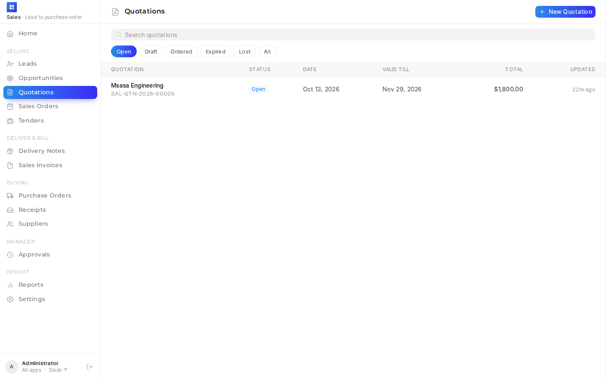
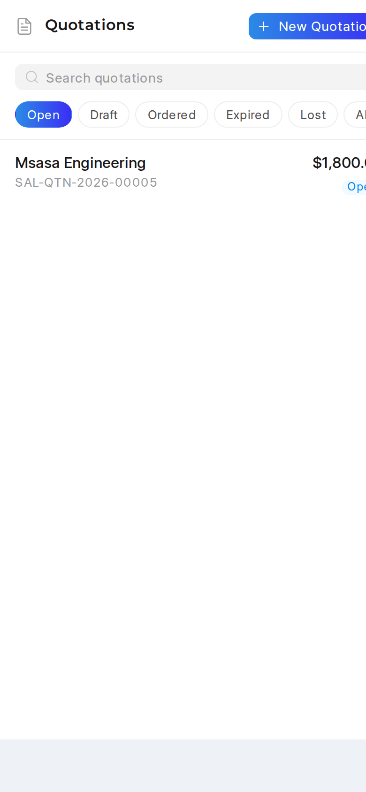
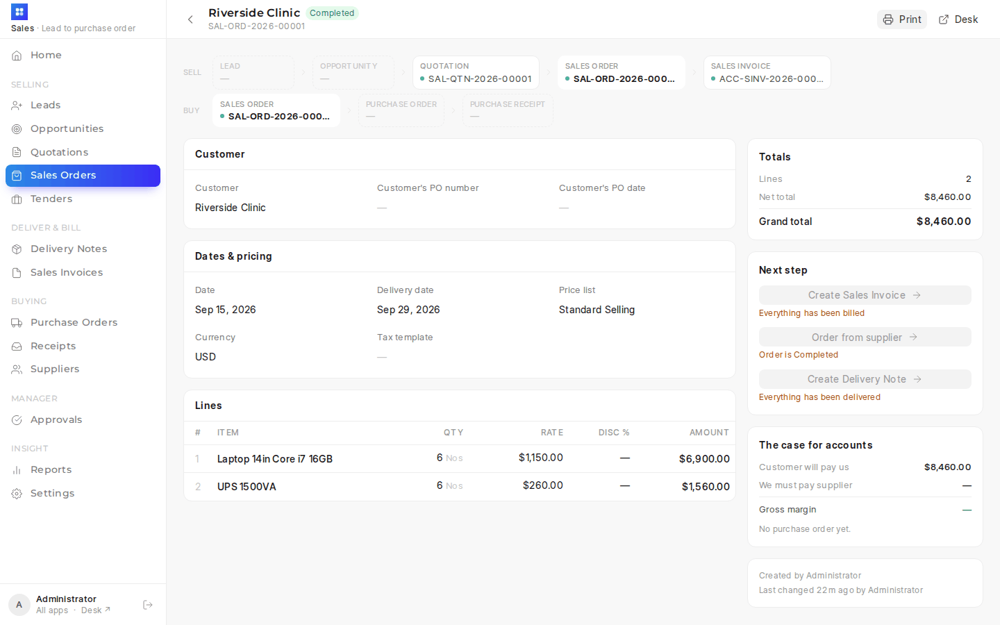
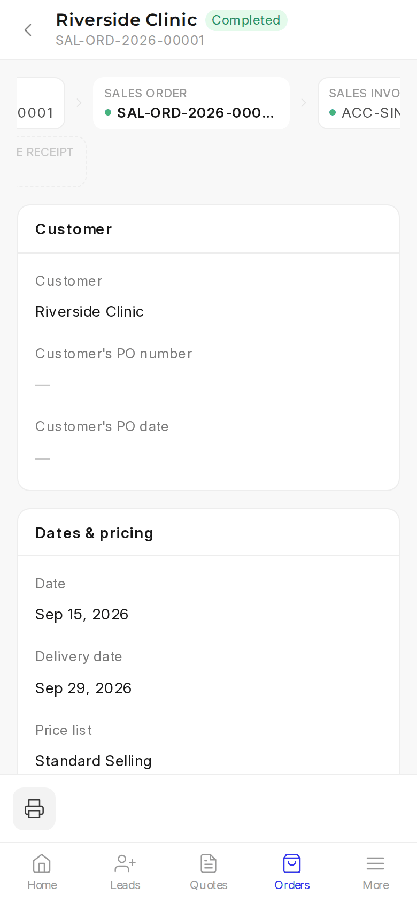

# Sales PWA (`/sales`)

<details><summary>Screenshots (demo data)</summary>

| Desktop | Phone |
|---|---|
|  |  |
|  |  |
|  |  |
|  |  |
|  |  |

</details>

(The HR, accounts and admin sides are further apps in the same `frontend/` — see [hr-admin-pwa.md](hr-admin-pwa.md), [accounts-pwa.md](accounts-pwa.md) and [sysadmin-pwa.md](sysadmin-pwa.md). After login everyone lands on the `/launcher` launcher, with a tile per app they can open.)

A simplified UI for the sales team covering Lead → Opportunity → Quotation → Sales Order, then two branches off the order:

- **Sell:** Sales Order → Sales Invoice. A Delivery Note is optional, as signed proof of hand-over.
- **Buy:** Sales Order → **Order from supplier** (Purchase Order) → **Receive** (Purchase Receipt), when the goods arrive or the service is delivered. Material Requests aren't part of the sales app; for buying that isn't for a customer order they stay in desk.

Accounts then bills the order and pays it in the [accounts app](accounts-pwa.md) (We owe → Orders to bill). A supplier is paid only for what was received: see *Three-way match* below. It follows the Quote-to-PO training manual: every document is **created from the one before it** (the "Next step" panel), never typed fresh.

## What's where

| Path | Purpose |
|---|---|
| `frontend/` | Vue 3 + frappe-ui + Tailwind app (no Ionic). Built with Vite and vite-plugin-pwa. |
| `frontend/src/doctypes/index.js` | One config per document: curated fields, list columns, status chips, and the `nextSteps` flow. Add a field or doctype here. |
| `erp_overrides/api/sales.py` | Whitelisted backend: `make_next` (allow-listed ERPNext mappers), `get_chain`, `get_pipeline`, `get_approval_status` / `get_approvals` / `request_approval`, `get_margin`, `get_item_details` (also prices the accounts app's invoice lines), `get_tenders`, `get_my_report` (Home's My sales), `get_reports` (the Reports page). |
| `erp_overrides/api/reports.py` | `report_groups()`, shared with the accounts app: curated report groups, then every other enabled report in the given modules, only those the user may open. |
| `erp_overrides/www/sales.py` | Boot context (user, roles, company, price lists, approval limits, `can_view_tenders`, `is_sales_manager`). |
| `hooks.py` → `website_route_rules` | Sends every `/sales/*` path to the app. |

Build output (`erp_overrides/public/frontend/`, `erp_overrides/www/sales.html`) is git-ignored and produced on deploy.

## My sales (Home)

`get_my_report(scope)` feeds the **My sales** section on Home (`frontend/src/components/MySales.vue`). It covers the last 12 months of quoted, ordered and invoiced amounts, quote outcomes and win rate, the biggest customers and most-quoted items this fiscal year, and links to five desk reports (`MY_SALES_REPORTS`) with **All reports →**. Amounts are `base_net_total`, in the company currency.

Nobody is set up as a Sales Person, so a seller's figures are the documents they **own** (created). Sales Managers and System Managers can pass `scope="team"` to see everyone, plus a `by_seller` table. Anyone else is held to `"me"`. A doctype the user can't read is left out. The chart is the shared `frontend/src/components/BarChart.vue`, which the accounts app also uses.

## Reports (`/reports`)

Under *Insight* in the sidebar (and in **More** on a phone). My sales at the top, then every sales report the user's roles may open, as links into desk, with a search box (`frontend/src/pages/Reports.vue`, `components/ReportsGrid.vue`). `SALES_REPORTS` in `api/sales.py` groups them:

| Group | Reports |
|---|---|
| Pipeline | Lead Details, Sales Pipeline Analytics, Opportunity Summary by Sales Stage, Lost Opportunity, Prospects Engaged But Not Converted, Lead Conversion Time, Lead Owner Efficiency, Campaign Efficiency |
| Quotes and orders | Quotation Trends, Lost Quotations, Sales Order Analysis, Sales Order Trends, Pending SO Items For Purchase Request, Payment Terms Status for Sales Order |
| Sales | Sales Analytics, Territory-wise Sales, Sales Person-wise Transaction Summary, Item-wise Sales History, Customer-wise Item Price, Customer Acquisition and Loyalty, Inactive Customers, Customers Without Any Sales Transactions |
| Billing and money | Sales Invoice Trends, Sales Register, Item-wise Sales Register, Delivered Items To Be Billed, Gross Profit, Accounts Receivable (+ Summary), Customer Credit Balance, Sales Payment Summary |
| Delivery | Delivery Note Trends |
| Buying for orders | Purchase Order Analysis, Purchase Order Trends, Procurement Tracker |
| Other sales reports | Every other enabled report in the Selling and CRM modules, so new ones appear by themselves |

A report the role can't open (its *Roles* list in desk) isn't shown: a Sales User sees the pipeline and order reports, not Gross Profit or Accounts Receivable.

## Stock

For a business that mostly sells services and buys hardware only for an order, there is little store-house work (`erp_overrides/stock_light.py`):

- **Only hardware keeps stock**: items in the *Hardware* item group tree (in the demo: Laptops & Desktops, Networking Equipment, Printers, UPS & Accessories, each with its own income and cost of sales accounts and the Stores warehouse). Each may go negative. Everything else is non-stock, and new items start non-stock (Item → Maintain Stock defaults to off). An item already on submitted documents keeps its setting: ERPNext won't change it.
- **Receiving brings it in.** **Receive** on a submitted Purchase Order makes a Purchase Receipt for what is still to come; change the quantities to what actually arrived and submit. Hardware goes into Stores; for services the receipt only records that the work was delivered. The received quantity follows the quantity (`receipt_before_validate`), as ERPNext wants them equal.
- **The customer's invoice takes it out.** A draft Sales Invoice with hardware gets *Update Stock* and the default warehouse, and cost of sales posts to the item group's account. The supplier's invoice moves no stock (the receipt did).
- **A Delivery Note is optional proof.** If one is made, it moves the stock and the invoice made from it doesn't.
- **Sold before it's received:** allowed (negative stock). Submitting a Purchase Order sets the item's valuation rate, so the sale's cost is the order price; the receipt then brings stock back to zero.
- **Order from supplier** (`make_purchase_order_from_sales_order`) maps the order's not-yet-ordered quantities to a Purchase Order linked row by row (the order's *ordered qty* updates), leaves the supplier to pick, and starts each line at the last price paid (or the buying price list). Warehouse fields are gone from the forms; the server fills them on Sales Orders, Delivery Notes, Purchase Orders and Purchase Receipts.
- **Which warehouse:** Stock Settings → Default Warehouse where the ERPNext release still has that field, otherwise *Stores - <company abbr>*. The Hardware item groups default to Stores either way.

## Three-way match

(`erp_overrides/three_way.py`, patch `three_way_2026_10`). A supplier's bill line that comes from a Purchase Order must agree with the order line's receipts and price before it can be paid:

| Badge | Meaning |
|---|---|
| Matched | billed quantity (this bill plus earlier ones) ≤ received, and rate ≤ order rate + Accounts Settings → Over Billing Allowance |
| Not received | nothing received on the order line yet |
| Over-billed | more billed than received |
| Price differs | billed above the order's rate (ERPNext already stops a bill whose total exceeds the order; this catches a higher price on fewer units) |
| No PO | no order lines (ZESA, Econet, rent): paid as before |

A supplier payment (Payment Entry, *Pay* to a Supplier) that settles a bill that isn't Matched or No PO is refused on submit, wherever it's made: desk, the accounts app's Make a payment, We owe → Pay, or bank reconciliation. An Accounts Manager can tick **Approved unmatched payment** on the payment (permission level 1) to pay anyway; the bills and who approved are noted on the payment.

## Suppliers (`/suppliers`)

Upload suppliers from Excel or CSV (`erp_overrides/api/suppliers.py`, `frontend/src/pages/Suppliers.vue`), the same preview-then-apply pattern as the admin app's price import. Columns: `supplier_name`, `billing_currency` and `payment_terms` (required; terms must be an existing Payment Terms Template), then `supplier_group`, `country`, `tax_id`, `email_id`, `mobile_no`, `address_line1`, `city`. A name that already exists (case and spaces ignored) updates that supplier; any other creates one, with a primary contact and address when given. The page lists suppliers still missing currency or terms. Anyone who may create and edit Suppliers sees it (`can_import_suppliers` in the boot). Patch `supplier_terms_2026_10` adds starter terms (Due on receipt, 7 days, 30 days) where a site has none.

## Tax

Quotation, Sales Order and Sales Invoice have a **Tax template** field (Sales Taxes and Charges Template, filtered to the company). Picking one fills the tax rows with ERPNext's own `get_taxes_and_charges` (the `onChange` hook in `doctypes/index.js`); the rows show under Totals, and the amounts are worked out on save. Mapping carries the template and rows on (quotation → order → invoice). ERPNext applies no template by itself unless one is marked Default, and none is today: *Zimbabwe Tax - AS* (VAT 15.5%) has to be picked.

## Printing

**Print** on a submitted Quotation, Sales Order, Delivery Note, Sales Invoice or Purchase Order opens a preview with a print format and letter head selector. Each user's last choice is remembered per document type, in their browser.

- **Proforma invoice** sits next to Print on a submitted Sales Order and on an approved Quotation. It opens the same preview set to **Proforma Invoice** (or **Proforma Invoice (Quotation)**) and downloads `Proforma-<name>.pdf`. It doesn't change the format plain Print remembers. The button shows only where the format exists and is enabled (`proforma_formats()` in `api/sales.py`, sent in the boot); the formats come from patch `acc_setup_2026_10`.
- The HTML preview uses desk's own renderer (`frappe.www.printview.get_html_and_style`). Print Designer formats are previewed as the actual PDF.
- **Download PDF** uses the chosen format's PDF generator, falling back to Print Settings, then wkhtmltopdf (`erp_overrides.api.sales.download_pdf`).
- wkhtmltopdf uses an old WebKit with no flexbox or WebP support. A format that uses either can look right in the preview and still break in the PDF. The letter heads are patched (`patches/v1_0/letterhead_without_flexbox.py`); the "Official" quotation format is not yet.

## Permissions

The boot data carries each user's read/create rights per document. Menu items, "New" buttons, Home tiles and Create buttons are hidden or disabled to match, and the server still enforces every permission.

## Approvals

The PWA **mirrors** an approval rule enforced on the server (a server script that blocks submitting an order above the limits until the approval fields, at permlevel 1, are ticked) so it can warn before submit. The limits come from a **Custom Selling Settings** single doctype (`sales_order_limit`, `discount_limit`).

- Sellers see the amber banner and an "Ask a manager" button, which assigns the order to them.
- Sales Manager / Sales Master Manager see Approve buttons on the order and in **Approvals**.
- If the server-side rule is off, the PWA still holds unapproved orders back from Submit, but desk will not.

## Tenders (`/tenders`)

A dashboard of public tenders: Zimbabwe e-GP (**Egp Tender**) and Zambia ZPPA (**Eprocure Tender**), filled by the feeds in `erp_overrides/scrapers.py` (stubs in this repo; see [sadc-data-feeds.md](sadc-data-feeds.md) for extending it across SADC). These are the same records the daily digest email sends (`tender_digest.py`).

- **Tiles:** open tenders, open per country, closing this week, and new (picked up in the last 24h). Click a tile to switch to that view.
- **Filters:** country, view (Open / Closing this week / New / Closed, where Closed covers the last 30 days), search on title, entity or reference, and category (the side panel on desktop, a dropdown on mobile). Filters live in the URL, so a view can be bookmarked or shared.
- **Each tender:** ZW/ZM tag, title, procuring entity, closing date with a time-left badge (red inside 3 days, amber inside 7, the same as the digest), reference, method, categories, a portal link, and the notice PDF for Zambia.
- The header shows when each country last had a tender picked up. If one stops moving, check its feed.

Access: anyone who can read Lead or Opportunity. Both tender doctypes stay System-Manager-only in desk, so `get_tenders` reads them server-side after that check. e-GP stores several categories in one field joined by a bare comma (commas inside a name are followed by a space). `get_tenders` splits on that.

## Settings (`/settings`)

Sales Manager and System Manager only: no menu entry for anyone else, and `erp_overrides/api/app_settings.py` refuses them. The page shows the approval limits (*Custom Selling Settings*: order limit, discount limit, payment entry limit), selling defaults (price list, whether a Sales Order or Delivery Note is required, same-rate rule, default customer group and territory) and stock (negative stock, and default warehouse on ERPNext releases that still have it), saved through the documents themselves, and a **Who changed what** panel: every change from Frappe's Version log (who, when, old → new), including changes made in desk. The fields shown are listed in `REGISTRY["sales"]`; a field missing on a site is skipped.

## Develop

```bash
cd apps/erp_overrides/frontend
yarn install
yarn dev            # http://<site>:8080/sales — proxies API calls to the bench on :8000
```

## Build / deploy

`yarn build` (or `bench build --app erp_overrides`) builds all four apps; the output is git-ignored. For development, `yarn dev` serves http://<site>:8080/sales with hot reload and proxies API calls to the bench on :8000.

```bash
bench --site $SITE migrate
bench build --app erp_overrides
bench --site $SITE clear-cache && bench restart
```

## Tests

```bash
bench --site <site> run-tests --app erp_overrides --module erp_overrides.tests.test_sales_api
bench --site <site> run-tests --app erp_overrides --module erp_overrides.tests.test_reports
bench --site <site> run-tests --app erp_overrides --module erp_overrides.tests.test_stock_light
bench --site <site> run-tests --app erp_overrides --module erp_overrides.tests.test_three_way
bench --site <site> run-tests --app erp_overrides --module erp_overrides.tests.test_suppliers
```

(This needs `allow_tests` on the site.)
