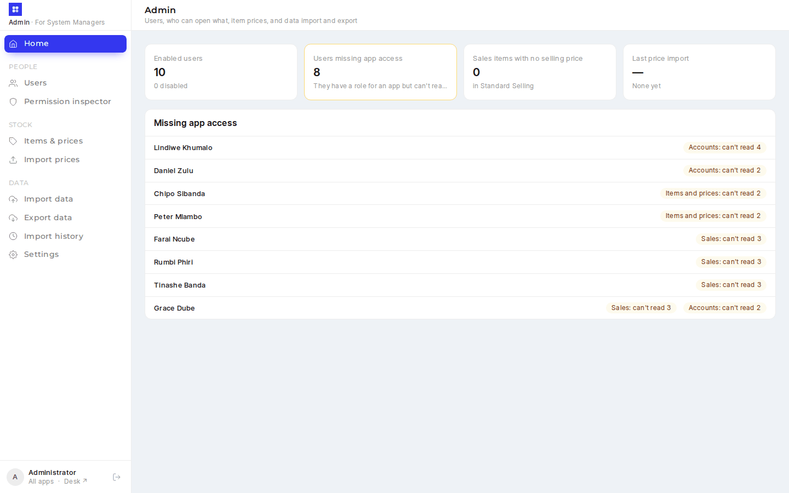
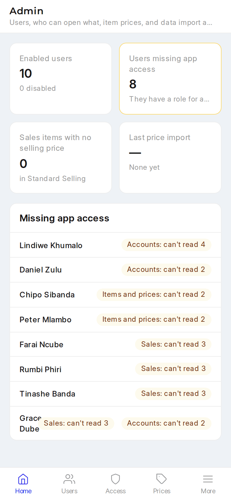
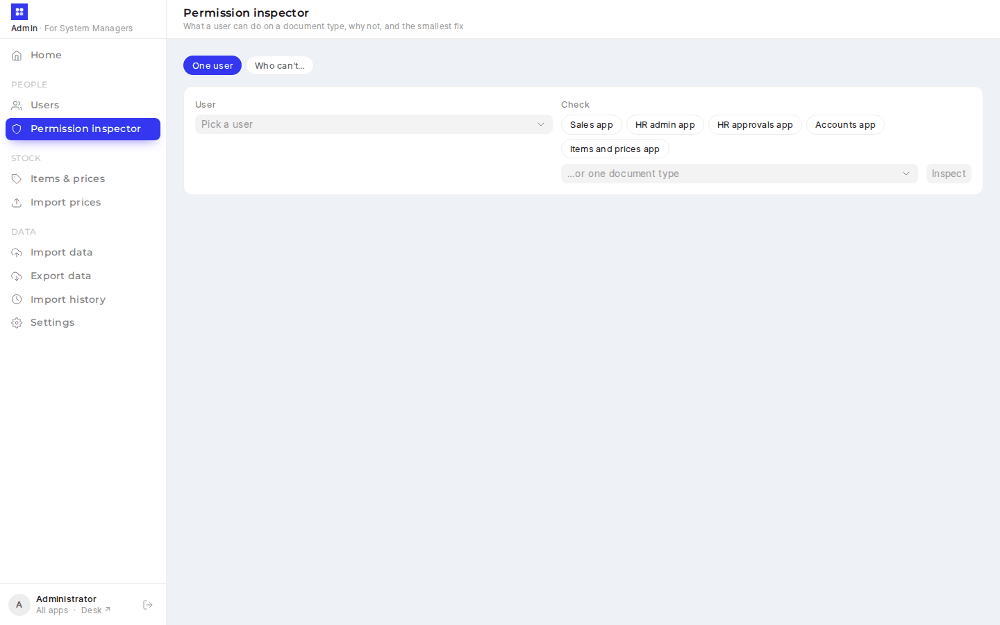
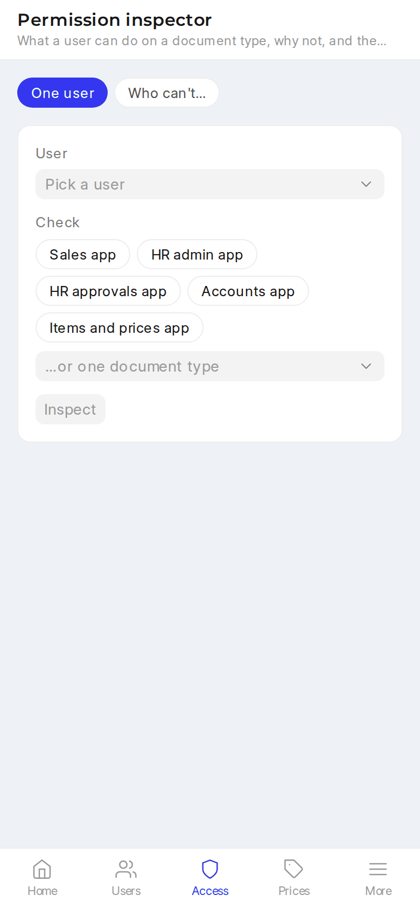

# Admin PWA (`/sys-admin`)

<details><summary>Screenshots (demo data)</summary>

| Desktop | Phone |
|---|---|
|  |  |
|  |  |
|  |  |
|  |  |

</details>

The System Manager's front door: users and roles, why someone can't open something (and the smallest fix), and item prices: inline edits, bulk export, and a bulk import that shows every change before it is applied. ERPNext still owns the data; every change goes through the documents themselves, so Frappe's Version log records who changed what, as it does for desk.

| Who | Sees |
|---|---|
| System Manager | Everything below |
| Anyone else | *Not Permitted*: the page and every API method refuse them |

## Pages

| Page | What it does |
|---|---|
| Home | Enabled users; users who have a role for an app but can't read what it shows; sales items with no price in the default selling list; the last price import |
| Users | Search and filter by role or enabled. Each user's role count, role profiles, and their apps (amber when something is missing). **New user** with role profiles or roles, and an optional welcome email |
| User | Apps and what's missing · role profiles (preview of roles added/removed before saving) · roles, split into app roles and the rest, saved as `+ role` / `− role` · enable/disable · User Permissions (remove; add in desk) · who changed what |
| Permission inspector | **One user** against an app's document types or a single document type: each permission ✓/✗ (or "own" for if-owner rules), *why* (Frappe's own permission debug log), User Permissions that limit records, and fixes. **Who can't…** lists enabled users missing a permission on a document type |
| Items & prices | Items with one price column per chosen price list. Click a price, type, and the bar at the bottom says exactly what changes (*Item · Price list (currency) · per unit · old → new*) before Enter saves. A cell with several prices (per customer, supplier, unit or date) opens a panel listing each, with its history |
| Import prices | Upload CSV/Excel → every row marked **New**, **Changed** (old → new per field), **Unchanged** or **Error** → **Apply N changes** |
| Settings | **Default selling price list** card: the current list and the one you pick side by side (currency, number of prices, sales items with no price, last change) and a warning when the currency or coverage gets worse. Below: default buying price list and Stock Settings (item naming, default unit, default warehouse, negative stock), with the shared *Who changed what* panel |

## Landing page (`/launcher`)

Everyone lands on `/launcher` after logging in: one tile per app the user's roles open (Sales, HR, Accounts, Admin), **My HR** (Frappe HR's own employee app at `/hrms`) and **Who's off** (the company leave calendar, `/hrms-admin/calendar`) for anyone linked to an Employee who hasn't left, plus **Desk** for System Users, laid out like desk's own desktop. A tile only shows when that app would let the user in, so nobody gets a tile that ends in *Not Permitted*. Every app's sidebar links back with **All apps**.

The page is a self-contained soft UI: white rounded tiles on a pale blue-grey ground, one solid blue for icons and anything active, Montserrat headings, and a dark variant that follows the user's desk theme. The four apps share the accent (`frontend/src/main.css`): the current sidebar item is a blue pill, and selected chips, steps and primary buttons take the same blue. With no logo set in Navbar or Website Settings, the app's own icon stands in for Frappe's.

How it's wired (`erp_overrides/www/launcher.py`, `hooks.py`):

- `get_website_user_home_page` → `launcher.home_page(user)`: `"launcher"` for any System User or anyone with a tile. Frappe asks this for system users too, so it replaces `/desk` after login and for `/`.
- `add_to_apps_screen` registers *Apps* (route `/launcher`) on Frappe's `/apps` screen and the desk app switcher, and patch `launcher_landing_2026_10` sets *System Settings → Default App* to it (only if empty), so someone already logged in who opens `/login` also goes to `/launcher`.
- Customers, suppliers and other website users with no tile keep Frappe's own home page.
- Frappe still puts two things ahead of the hook: a **home page on one of the user's roles** (Role → Home Page) and a user's **default workspace**. Clear those to send that user to `/launcher`. A user's own *Default App* (User → Default App) also wins over the system one.
- Frappe caches each user's home page; the patch clears that cache, and so does `bench clear-cache`.

## Suggested fixes

For each missing permission the inspector lists the roles that grant it (from DocPerm, or Custom DocPerm where a doctype has any), smallest first: app roles before others, then the role that opens the fewest other document types. **Apply** shows what the role also opens and saves it as a normal role change.

- **The user has role profiles:** in Frappe 16 a user's roles are re-set from their profiles on every save, so a role added by hand would silently disappear. The app refuses hand edits for such users and suggests a *profile* that carries a granting role instead; the role list says where the roles come from.
- **No role grants it** (e.g. Import on Bank Transaction is off for every role): a link to Role Permission Manager. Nothing is applied automatically.
- **Disabled user, or a Website User:** said at the top; no role fixes that.

Guards: Administrator and Guest can't be changed; you can't disable yourself or drop your own System Manager role; the last enabled System Manager keeps the role.

## Price import

Columns: `item_price_id, item_code, item_name, price_list, currency, uom, price_list_rate, valid_from, valid_upto, customer, supplier`. Only `item_code`, `price_list` and `price_list_rate` are required; `item_name` and `currency` are ignored (they're there to read). **Export** writes exactly this layout (Excel or CSV, optionally with blank rows for items that have no price yet), and **Template** gives the headers only.

- **Matching:** by `item_price_id` when given, else by item, list, unit, customer and supplier (plus `valid_from` when the row has one). Two prices matching one row is an error asking for the id.
- **Blank cells:** a blank `uom` or `valid_from` keeps the price's own (ERPNext fills both on every price); a blank `valid_upto`, `customer` or `supplier` means none.
- **Errors:** unknown item, price list, unit, customer or supplier; a price that isn't a number or is negative; a bad date; the same price twice in the file. A disabled item is a warning.
- **Preview, then apply:** the preview is kept on the server for 30 minutes and applied exactly as shown. A price someone changed after the preview is **skipped**, not overwritten; skipped and failed rows can be downloaded. Prices missing from the file are left alone (no deletes).

Export, re-import unchanged gives all rows *Unchanged*.

## What's where

| Path | Purpose |
|---|---|
| `erp_overrides/api/sysadmin.py` | Whitelisted backend: users, roles, profiles, inspector, prices, export/import, price list facts, home. `APPS` lists each app's roles and the document types its access check covers |
| `erp_overrides/api/app_settings.py` | `REGISTRY["sysadmin"]` (Settings page); `save_settings` now refuses a link to a disabled record (any app) |
| `erp_overrides/www/sys_admin.py` | Page boot; refuses anyone but System Managers |
| `frontend/sysadmin.html`, `frontend/vite.sysadmin.config.js` | Fourth Vite entry (dev port 8083), output `erp_overrides/public/sys-admin` |
| `frontend/src/sysadmin/` | `api.js` (`adm()`, `download()`), `components/AdminShell.vue`, `pages/` |
| `frontend/src/components/SettingsPage.vue` | Shared settings page; new `hideSections` prop and `before` slot |
| `erp_overrides/www/launcher.py`, `www/launcher.html` | The `/launcher` landing page and `home_page()`; `tests/test_launcher.py` (tiles per role, My HR for linked employees, guests to login, who lands here) |
| `erp_overrides/tests/test_sysadmin_api.py` | 16 tests: access, roles and guards, profiles, create user, inspector (missing role → fix → allowed, User Permission reported, app check), inline prices (create, update, someone else changed it, several prices), import (statuses, apply, used-up token, changed after preview, hand-made row matching, export round trip), default price list (change, disabled refused) |

## Build / deploy

`yarn build` (or `bench build --app erp_overrides`) builds all four apps; the output is git-ignored. For development, `yarn dev:sysadmin` serves http://<site>:8083/sys-admin with hot reload and proxies API calls to the bench on :8000.

```bash
bench --site $SITE migrate
bench build --app erp_overrides
bench --site $SITE clear-cache && bench restart
```
